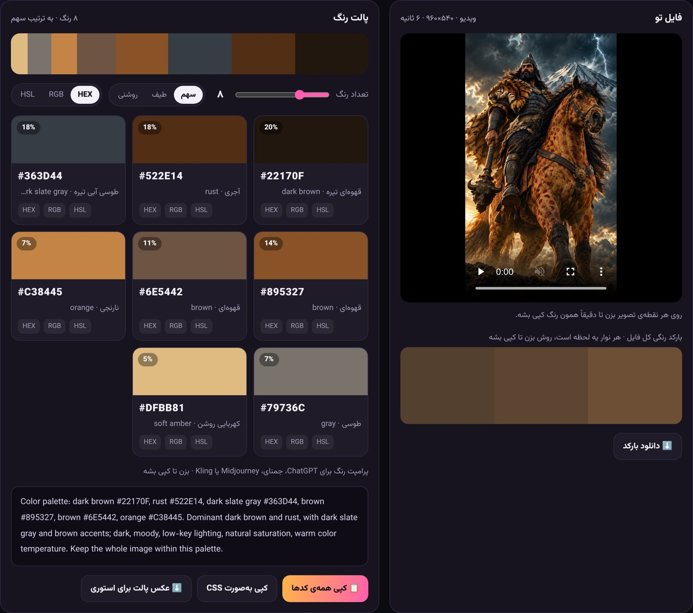
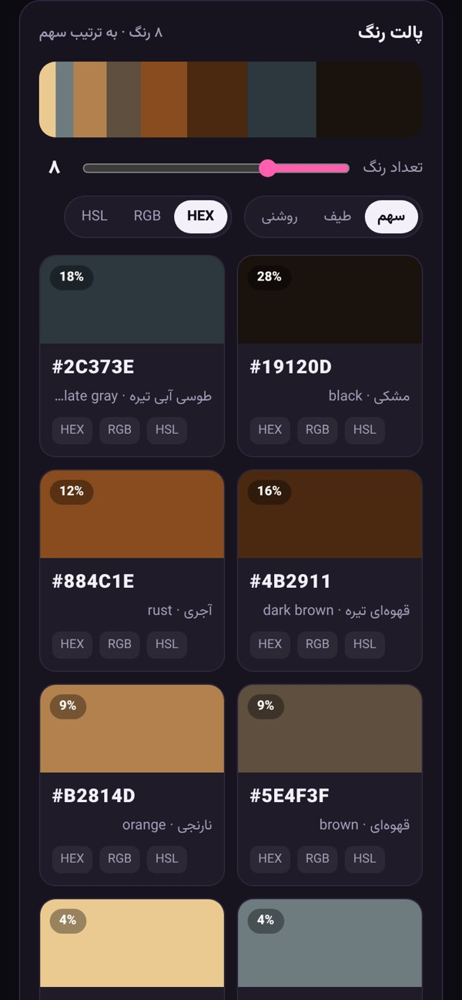
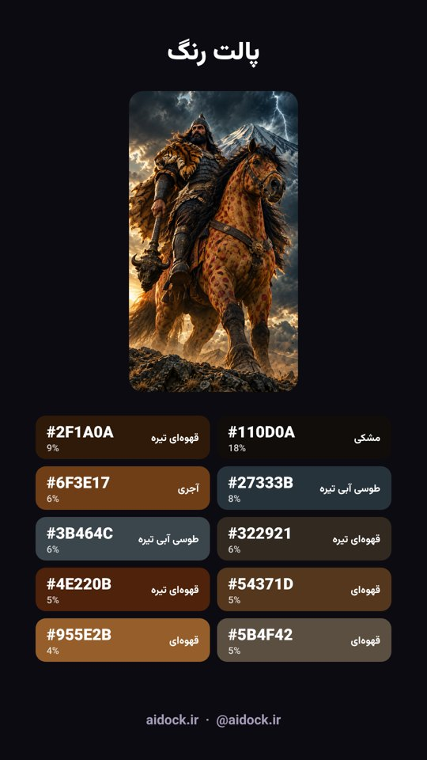

# رنگ‌یاب آی‌داک · AiDock Palette

پالت رنگ هر عکس، ویدیو یا گیف رو دربیار و با یه کلیک کپی کن. مستقیم در مرورگر، بدون نصب، بدون اینترنت. فایلت از گوشی یا کامپیوترت بیرون نمی‌ره.

## امکانات

- **عکس، ویدیو و گیف:** JPG، PNG، WEBP، AVIF، SVG، MP4، WEBM، MOV و گیف متحرک
- **پالت ۳ تا ۲۰ رنگی:** با درصد سهم هر رنگ و اسم فارسی و انگلیسی
- **کپی با یه کلیک:** HEX، RGB یا HSL؛ کپی همه‌ی کدها یا به‌صورت متغیرهای CSS
- **قطره‌چکان:** روی هر نقطه‌ی عکس یا فریم ویدیو بزن تا دقیقاً همون رنگ کپی بشه
- **بارکد رنگی:** رنگ هر لحظه‌ی ویدیو و گیف در یه نوار؛ روش بزن تا رنگ همون لحظه کپی بشه
- **پرامپت رنگ آماده:** برای ChatGPT، جمنای، Midjourney و Kling تا عکست دقیقاً همون حس رو بگیره
- **عکس پالت برای استوری:** ۱۰۸۰ در ۱۹۲۰، آماده‌ی انتشار
- **مرتب‌سازی:** بر اساس سهم، طیف رنگ یا روشنی
- **حریم خصوصی کامل:** همه‌چیز روی دستگاه خودت پردازش می‌شه

## استفاده

1. فایل `index.html` رو دانلود کن و با **کروم** یا **سافاری** باز کن.
2. عکس، ویدیو یا گیف رو بنداز توی صفحه، یا بزن و از گالری انتخاب کن.
3. روی هر رنگ بزن تا کپی بشه.

 &nbsp; 

## مجوز

© ۱۴۰۵ [aidock.ir](https://aidock.ir). همه‌ی حقوق محفوظ است؛ جزئیات در [LICENSE](LICENSE).

---

**AiDock Palette** is a single-file, offline browser tool that extracts the color palette of any image, video or GIF: 3 to 20 colors with their share, one-click copy as HEX, RGB or HSL, an eyedropper, a color barcode of every moment in a video, a ready-made color prompt for AI image and video models, and a 1080×1920 palette image for stories. Nothing is uploaded; everything runs on your device. Made by [aidock.ir](https://aidock.ir).
